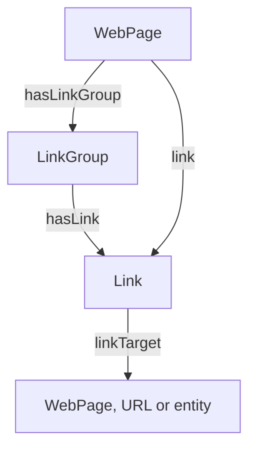

# Links

A **`Link`** is one hyperlink found on a `WebPage`: an `<a href>` element, with its anchor text, its `rel` tokens, its place in the layout and its destination. With destinations recorded, the links of a site form a graph, and the usual internal-linking work becomes a query over that graph:

- Which pages link to a given page, with what anchor text, and from which part of the layout?
- Which of those anchors are editorial, and which are site-wide navigation or footer boilerplate?
- Which internal links point at pages that return an error?
- Which internal links carry `nofollow`?

!!! tip "Short version"
    Emit one `Link` per `<a href>`, with `linkTargetUrl` (the href) and `linkText` (the anchor). Put navigation, footer and other blocks of links in a `LinkGroup` with a `linkGroupType`. Add `linkTarget` (the destination node) only once you have resolved the href to a page or entity.

On this page, the **href** is the URL written in the markup, recorded with `linkTargetUrl`, and the **destination** is the node that href resolves to, recorded with `linkTarget`.

## The model at a glance



A page reaches its links in one of two ways:

- **Grouped**: `hasLinkGroup` from the `WebPage` to a **`LinkGroup`**, then `hasLink` from the group to each `Link`. Use this for blocks of related links: the main navigation, the footer, a sidebar, a "Related insights" block.
- **Ungrouped**: `link` straight from the `WebPage` to the `Link`. Use this for raw extracted links before any grouping pass, and for single inline links in body text.

### Link

| Term | Value | Notes |
|---|---|---|
| `linkTargetUrl` | string | The href, absolute and resolved against the page's base URL. Always set it. |
| `linkTarget` | node | The destination: a `WebPage`, a `URL` node or an entity. Set it only once resolved. Inverse: `isLinkTargetOf`. |
| `linkText` | literal | The anchor text. May carry a language tag. |
| `linkRel` | string | One `rel` token per value: `nofollow`, `sponsored`, `ugc`, `noopener`, and so on. |
| `linkLocation` | placement | Placement of an ungrouped link. |
| `position` | number | Order of the link within its group. |

### LinkGroup

| Term | Value | Notes |
|---|---|---|
| `hasLink` | `Link` | Each link in the group. Inverse: `isLinkOf`. |
| `linkGroupType` | placement | Placement of the whole group. Takes precedence over `linkLocation`. |
| `linkGroupName` | string | Display name, for example "Footer links". |
| `linkGroupID` | string | Identifier of the group. |

### WebPage

| Term | Value | Notes |
|---|---|---|
| `hasLinkGroup` | `LinkGroup` | Grouped links. Inverse: `isLinkGroupOf`. |
| `link` | `Link` | Ungrouped links. |

**placement** is one of `header`, `footer`, `body`, `sidebar` or `navigation`. The [ontology reference](https://seontology.github.io/seontology/reference/) lists the formal domain and range of each term.

## Why it is modeled this way

**Two properties for where a link points.** A parser knows the href, a string. A resolver knows, later, the node the href stands for: a page in the graph, a `URL` node, or an entity. OWL 2 DL does not allow one property to take both a string and a node, so there are two: `linkTargetUrl` for the href, always present, and `linkTarget` for the destination, present once resolved. Because `linkTarget` ranges over `schema:Thing`, one property covers every kind of destination, and a query narrows it with a type filter.

**The href belongs to the link, not to a page identity.** Many links share one href, and a page can link to the same URL several times. `linkTargetUrl` is a plain value on the `Link`, so two links to the same href simply share a value. It is deliberately not a `URL` node via `hasURL`: that property is functional and inverse-functional, which makes the `URL` node a key for *page* identity.

**Placement is a fixed set of values.** `linkGroupType` and `linkLocation` share one enumeration, so a consumer can filter out boilerplate without guessing at free text. When a link sits in a `LinkGroup`, the group's `linkGroupType` applies and `linkLocation` is redundant. `linkLocation` exists for ungrouped links, which have no group to carry their placement.

**Internal or external is derived, not stored.** A link is internal when its source page and its destination share a `Domain`. Comparing domains handles subdomains and multi-domain brands, which a stored `internal` / `external` flag cannot, and it never goes stale when a site's domain setup changes.

**`rel` is a list of tokens.** HTML allows several `rel` tokens on one link, for example `nofollow noopener`. `linkRel` holds one token per value, so `sponsored` and `ugc` are as easy to express as `nofollow`, and no separate boolean can contradict them.

## Examples

Each example is shown in three syntaxes that produce the same RDF graph. Pick one and every example on the page switches to it.

- **JSON-LD** is what most producers emit.
- **YAML-LD** is JSON-LD written as YAML ([W3C Working Draft](https://www.w3.org/TR/yaml-ld-10/), media type `application/ld+yaml`). It allows comments, so **comments explaining each property appear in the YAML-LD tab**.
- **Turtle** is what you load into a triple store.

The JSON-LD and YAML-LD examples use the SEOntology JSON-LD context, `https://w3id.org/seovoc/context.jsonld`, which maps short names such as `linkTargetUrl` to their `seovoc:` IRIs. The Turtle examples set `@base <https://example.com/>`, so `<outlook/>` stands for `https://example.com/outlook/`.

### 1. Minimal link

The least a crawler can say about a link, and enough to start building a link graph: the page, the anchor text and the href. The link sits inline in body text, so it is ungrouped and states its own placement with `linkLocation`.

=== "JSON-LD"

    ```json
    {
      "@context": "https://w3id.org/seovoc/context.jsonld",
      "@id": "https://example.com/outlook/",
      "@type": "WebPage",
      "link": {
        "@type": "Link",
        "linkText": "where wealth managers see 2026 risk",
        "linkTargetUrl": "https://example.com/wealth/",
        "linkLocation": "body"
      }
    }
    ```

=== "YAML-LD"

    ```yaml
    "@context": https://w3id.org/seovoc/context.jsonld
    "@id": https://example.com/outlook/
    "@type": WebPage
    # An inline link in body text, so it is ungrouped
    link:
      "@type": Link
      # The anchor text, as it appears on the page
      linkText: where wealth managers see 2026 risk
      # The href, made absolute against the page's URL
      linkTargetUrl: https://example.com/wealth/
      # Placement, because there is no LinkGroup to carry it
      linkLocation: body
    ```

=== "Turtle"

    ```turtle
    @base   <https://example.com/> .
    @prefix seovoc: <https://w3id.org/seovoc/> .

    <outlook/> a seovoc:WebPage ;
        seovoc:link [
            a seovoc:Link ;
            seovoc:linkText "where wealth managers see 2026 risk" ;
            seovoc:linkTargetUrl "https://example.com/wealth/" ;
            seovoc:linkLocation "body"
        ] .
    ```

### 2. Navigation group

The main navigation of the same page, as a `LinkGroup`. The first link has been resolved to a page in the graph, so it carries `linkTarget` as well as `linkTargetUrl`, and the destination's `status` is a single lookup away. The second link points at a page that has not been crawled, so it has an href and no destination.

=== "JSON-LD"

    ```json
    {
      "@context": "https://w3id.org/seovoc/context.jsonld",
      "@graph": [
        {
          "@id": "https://example.com/outlook/",
          "@type": "WebPage",
          "hasLinkGroup": {
            "@id": "https://example.com/outlook/#nav",
            "@type": "LinkGroup",
            "linkGroupID": "main-nav",
            "linkGroupName": "Main navigation",
            "linkGroupType": "navigation",
            "hasLink": [
              {
                "@type": "Link",
                "position": 1,
                "linkText": "Wealth Management",
                "linkTargetUrl": "https://example.com/wealth/",
                "linkTarget": "https://example.com/wealth/"
              },
              {
                "@type": "Link",
                "position": 2,
                "linkText": "Investment Banking",
                "linkTargetUrl": "https://example.com/banking/"
              }
            ]
          }
        },
        {
          "@id": "https://example.com/wealth/",
          "@type": "WebPage",
          "status": 200
        }
      ]
    }
    ```

=== "YAML-LD"

    ```yaml
    "@context": https://w3id.org/seovoc/context.jsonld
    "@graph":
      - "@id": https://example.com/outlook/
        "@type": WebPage
        # A block of links on this page
        hasLinkGroup:
          "@id": https://example.com/outlook/#nav
          "@type": LinkGroup
          # Identifier of the group, a string
          linkGroupID: main-nav
          # Display name, usually a heading or landmark label
          linkGroupName: Main navigation
          # Placement of every link in the group
          linkGroupType: navigation
          hasLink:
            - "@type": Link
              # Order within the group
              position: 1
              linkText: Wealth Management
              linkTargetUrl: https://example.com/wealth/
              # Resolved: the destination is a page in this graph
              linkTarget: https://example.com/wealth/
            - "@type": Link
              position: 2
              linkText: Investment Banking
              # Not crawled yet: an href, but no destination
              linkTargetUrl: https://example.com/banking/

      # The destination page, in the same graph
      - "@id": https://example.com/wealth/
        "@type": WebPage
        # HTTP status of the destination
        status: 200
    ```

=== "Turtle"

    ```turtle
    @base   <https://example.com/> .
    @prefix seovoc: <https://w3id.org/seovoc/> .
    @prefix xsd:    <http://www.w3.org/2001/XMLSchema#> .

    <outlook/> a seovoc:WebPage ;
        seovoc:hasLinkGroup <outlook/#nav> .

    <outlook/#nav> a seovoc:LinkGroup ;
        seovoc:linkGroupID "main-nav" ;
        seovoc:linkGroupName "Main navigation" ;
        seovoc:linkGroupType "navigation" ;
        seovoc:hasLink [
            a seovoc:Link ;
            seovoc:position 1 ;
            seovoc:linkText "Wealth Management" ;
            seovoc:linkTargetUrl "https://example.com/wealth/" ;
            seovoc:linkTarget <wealth/>
        ] , [
            a seovoc:Link ;
            seovoc:position 2 ;
            seovoc:linkText "Investment Banking" ;
            seovoc:linkTargetUrl "https://example.com/banking/"
        ] .

    <wealth/> a seovoc:WebPage ;
        seovoc:status "200"^^xsd:int .
    ```

### 3. Two anchors, one target

The same page linked twice from one page: from the navigation with a generic anchor, and from an editorial "Related insights" block with a descriptive one. The two links are separate `Link` nodes with the same `linkTargetUrl` value, which is how you compare the anchors that point at one page. The editorial anchor carries a language tag.

=== "JSON-LD"

    ```json
    {
      "@context": "https://w3id.org/seovoc/context.jsonld",
      "@id": "https://example.com/outlook/",
      "@type": "WebPage",
      "hasLinkGroup": [
        {
          "@type": "LinkGroup",
          "linkGroupName": "Main navigation",
          "linkGroupType": "navigation",
          "hasLink": {
            "@type": "Link",
            "linkText": "Wealth Management",
            "linkTargetUrl": "https://example.com/wealth/"
          }
        },
        {
          "@type": "LinkGroup",
          "linkGroupName": "Related insights",
          "linkGroupType": "body",
          "hasLink": {
            "@type": "Link",
            "linkText": {
              "@value": "where wealth managers see 2026 risk",
              "@language": "en"
            },
            "linkTargetUrl": "https://example.com/wealth/"
          }
        }
      ]
    }
    ```

=== "YAML-LD"

    ```yaml
    "@context": https://w3id.org/seovoc/context.jsonld
    "@id": https://example.com/outlook/
    "@type": WebPage
    hasLinkGroup:
      # Boilerplate: repeated on every page of the site
      - "@type": LinkGroup
        linkGroupName: Main navigation
        linkGroupType: navigation
        hasLink:
          "@type": Link
          # Generic anchor, chosen for navigation
          linkText: Wealth Management
          linkTargetUrl: https://example.com/wealth/
      # Editorial: specific to this page
      - "@type": LinkGroup
        linkGroupName: Related insights
        linkGroupType: body
        hasLink:
          "@type": Link
          # Descriptive anchor, with a language tag
          linkText:
            "@value": where wealth managers see 2026 risk
            "@language": en
          # The same href as the navigation link
          linkTargetUrl: https://example.com/wealth/
    ```

=== "Turtle"

    ```turtle
    @base   <https://example.com/> .
    @prefix seovoc: <https://w3id.org/seovoc/> .

    <outlook/> a seovoc:WebPage ;
        seovoc:hasLinkGroup [
            a seovoc:LinkGroup ;
            seovoc:linkGroupName "Main navigation" ;
            seovoc:linkGroupType "navigation" ;
            seovoc:hasLink [
                a seovoc:Link ;
                seovoc:linkText "Wealth Management" ;
                seovoc:linkTargetUrl "https://example.com/wealth/"
            ]
        ] , [
            a seovoc:LinkGroup ;
            seovoc:linkGroupName "Related insights" ;
            seovoc:linkGroupType "body" ;
            seovoc:hasLink [
                a seovoc:Link ;
                seovoc:linkText "where wealth managers see 2026 risk"@en ;
                seovoc:linkTargetUrl "https://example.com/wealth/"
            ]
        ] .
    ```

### 4. Outbound link with rel

A link to another site, with two `rel` tokens. `linkRel` takes one value per token, so the full list is kept: `nofollow`, `sponsored` and `ugc` are hints search engines read, and `noopener` matters for security audits. There is no `linkTarget`: the destination is outside the graph, so the href is all there is to record.

=== "JSON-LD"

    ```json
    {
      "@context": "https://w3id.org/seovoc/context.jsonld",
      "@id": "https://example.com/outlook/",
      "@type": "WebPage",
      "link": {
        "@type": "Link",
        "linkText": "the Federal Reserve's policy statement",
        "linkTargetUrl": "https://www.federalreserve.gov/monetarypolicy.htm",
        "linkLocation": "body",
        "linkRel": ["nofollow", "noopener"]
      }
    }
    ```

=== "YAML-LD"

    ```yaml
    "@context": https://w3id.org/seovoc/context.jsonld
    "@id": https://example.com/outlook/
    "@type": WebPage
    link:
      "@type": Link
      linkText: the Federal Reserve's policy statement
      # Another site: an href, and no destination node
      linkTargetUrl: https://www.federalreserve.gov/monetarypolicy.htm
      linkLocation: body
      # Every rel token in the markup, one value each
      linkRel:
        - nofollow
        - noopener
    ```

=== "Turtle"

    ```turtle
    @base   <https://example.com/> .
    @prefix seovoc: <https://w3id.org/seovoc/> .

    <outlook/> a seovoc:WebPage ;
        seovoc:link [
            a seovoc:Link ;
            seovoc:linkText "the Federal Reserve's policy statement" ;
            seovoc:linkTargetUrl
                "https://www.federalreserve.gov/monetarypolicy.htm" ;
            seovoc:linkLocation "body" ;
            seovoc:linkRel "nofollow" , "noopener"
        ] .
    ```

### 5. Internal vs external

Whether a link is internal is not stored on the link. Give pages a `Domain` with `hasDomain`: a link is internal when its destination page has the same `Domain` as the source page. For a destination that was never crawled, compare the host of its `linkTargetUrl` with the source page's `domainName`.

=== "JSON-LD"

    ```json
    {
      "@context": "https://w3id.org/seovoc/context.jsonld",
      "@graph": [
        {
          "@id": "https://example.com/outlook/",
          "@type": "WebPage",
          "hasDomain": "https://example.com/#domain",
          "link": [
            {
              "@type": "Link",
              "linkText": "where wealth managers see 2026 risk",
              "linkTargetUrl": "https://example.com/wealth/",
              "linkTarget": "https://example.com/wealth/"
            },
            {
              "@type": "Link",
              "linkText": "the Federal Reserve's policy statement",
              "linkTargetUrl": "https://www.federalreserve.gov/monetarypolicy.htm"
            }
          ]
        },
        {
          "@id": "https://example.com/wealth/",
          "@type": "WebPage",
          "hasDomain": "https://example.com/#domain"
        },
        {
          "@id": "https://example.com/#domain",
          "@type": "Domain",
          "domainName": "example.com"
        }
      ]
    }
    ```

=== "YAML-LD"

    ```yaml
    "@context": https://w3id.org/seovoc/context.jsonld
    "@graph":
      - "@id": https://example.com/outlook/
        "@type": WebPage
        # The source page's domain
        hasDomain: https://example.com/#domain
        link:
          # Internal: the destination has the same Domain
          - "@type": Link
            linkText: where wealth managers see 2026 risk
            linkTargetUrl: https://example.com/wealth/
            linkTarget: https://example.com/wealth/
          # External: no destination, and the href host
          # differs from the source page's domainName
          - "@type": Link
            linkText: the Federal Reserve's policy statement
            linkTargetUrl: https://www.federalreserve.gov/monetarypolicy.htm

      - "@id": https://example.com/wealth/
        "@type": WebPage
        # The same Domain node: this is what "internal" means
        hasDomain: https://example.com/#domain

      - "@id": https://example.com/#domain
        "@type": Domain
        # The host, for comparing with hrefs that were not crawled
        domainName: example.com
    ```

=== "Turtle"

    ```turtle
    @base   <https://example.com/> .
    @prefix seovoc: <https://w3id.org/seovoc/> .

    <outlook/> a seovoc:WebPage ;
        seovoc:hasDomain <#domain> ;
        seovoc:link [
            a seovoc:Link ;
            seovoc:linkText "where wealth managers see 2026 risk" ;
            seovoc:linkTargetUrl "https://example.com/wealth/" ;
            seovoc:linkTarget <wealth/>
        ] , [
            a seovoc:Link ;
            seovoc:linkText "the Federal Reserve's policy statement" ;
            seovoc:linkTargetUrl
                "https://www.federalreserve.gov/monetarypolicy.htm"
        ] .

    <wealth/> a seovoc:WebPage ;
        seovoc:hasDomain <#domain> .

    <#domain> a seovoc:Domain ;
        seovoc:domainName "example.com" .
    ```

## Querying the link graph

=== "Inbound links"

    Pages that link to a page, with anchor text and placement, excluding navigation and footer boilerplate. The query matches on the `linkTargetUrl` value, so it also finds links whose destination was never resolved, and it covers both grouped and ungrouped links.

    ```sparql
    PREFIX seovoc: <https://w3id.org/seovoc/>

    SELECT ?page ?text ?placement
    WHERE {
      ?link seovoc:linkTargetUrl "https://example.com/wealth/" .
      OPTIONAL { ?link seovoc:linkText ?text }
      {
        ?page seovoc:hasLinkGroup ?group .
        ?group seovoc:hasLink ?link .
        OPTIONAL { ?group seovoc:linkGroupType ?placement }
      } UNION {
        ?page seovoc:link ?link .
        OPTIONAL { ?link seovoc:linkLocation ?placement }
      }
      FILTER (!BOUND(?placement)
              || ?placement NOT IN ("header", "footer", "navigation"))
    }
    ```

=== "Broken links"

    Links whose destination returns an HTTP error.

    ```sparql
    PREFIX seovoc: <https://w3id.org/seovoc/>

    SELECT ?page ?href ?status
    WHERE {
      { ?page seovoc:link ?link }
      UNION
      { ?page seovoc:hasLinkGroup/seovoc:hasLink ?link }
      ?link seovoc:linkTargetUrl ?href ;
            seovoc:linkTarget ?target .
      ?target seovoc:status ?status .
      FILTER (?status >= 400)
    }
    ```

=== "Nofollow internal"

    Links that carry `nofollow` and point at a page on the source page's own domain.

    ```sparql
    PREFIX seovoc: <https://w3id.org/seovoc/>

    SELECT ?page ?href
    WHERE {
      { ?page seovoc:link ?link }
      UNION
      { ?page seovoc:hasLinkGroup/seovoc:hasLink ?link }
      ?link seovoc:linkRel "nofollow" ;
            seovoc:linkTargetUrl ?href ;
            seovoc:linkTarget ?target .
      ?page seovoc:hasDomain ?domain .
      ?target seovoc:hasDomain ?domain .
    }
    ```

## Guidance

These recommendations follow Google's documentation on [crawlable links](https://developers.google.com/search/docs/crawling-indexing/links-crawlable) and [qualifying outbound links](https://developers.google.com/search/docs/crawling-indexing/qualify-outbound-links), and common practice in crawlers that audit links.

!!! tip "Capturing links"
    - **Record `<a href>` elements.** They are the links search engines reliably follow. Elements that act as links only through JavaScript, and `javascript:` hrefs, are not links in this sense.
    - **Always set `linkTargetUrl`**, absolute and resolved against the page's base URL. Otherwise keep it as the page wrote it: do not replace it with the canonical URL or the URL after redirects. That belongs in `linkTarget`, which points at the destination's `WebPage` node.
    - **Set `linkText` to the anchor as it appears on the page.** Keep empty or generic anchors ("click here", "read more") as they are: finding them is part of an audit.
    - **Split `rel` into tokens**, one `linkRel` value each, lowercased. HTML separates tokens with spaces; split on commas as well, because some sites use them.
    - **Use `position` for document order within a group.** It supports analysis; it does not imply that the first link to a URL counts more, which Google has not documented.

!!! tip "Placement"
    - **Group links that belong together** (navigation, footer, a related-content block) in a `LinkGroup` and set its `linkGroupType`. Do not create a `LinkGroup` for one inline link in body text: use `link` and `linkLocation`.
    - **Placement is a heuristic.** Crawlers classify it differently, from HTML landmarks such as `<nav>` and `<footer>`, from CSS selectors or from rendering. Document which method your pipeline uses, so consumers know how far to trust a `navigation` or `body` value.

!!! warning "Avoid"
    - Putting anchor text, or several hrefs, in `linkTargetUrl`.
    - Packing several `rel` tokens into one value, such as `"nofollow noopener"`.
    - Setting `linkTarget` before you have resolved the href. Leave it out until you know what it points at.
    - Storing internal or external as a flag. Derive it from `Domain`, as in example 5.
    - Using the deprecated terms below in new data.

!!! note "`rel` and placement are signals, not rules"
    `rel` values describe the publisher's intent. Google treats `nofollow`, `sponsored` and `ugc` as [hints](https://developers.google.com/search/blog/2019/09/evolving-nofollow-new-ways-to-identify), not directives, so a query over `linkRel` tells you what the site declared, not how a search engine handled the link. Likewise, Google has said informally that it tells primary content apart from boilerplate but does not document how: use placement to focus your own analysis, not as a ranking rule.

## Migrating from deprecated terms

Earlier versions modeled links with terms that are now deprecated. Their IRIs still resolve and existing data stays valid, but new data should use the replacements.

| Deprecated | Use instead |
|---|---|
| `anchorResource` | `linkTarget` |
| `linkgroupID` | `linkGroupID`, a string rather than an integer |
| `noFollow` | `linkRel` with the value `nofollow` |
| `linkType` | Nothing: derive internal or external from `Domain`, as in example 5 |
| `AnchorText` (class) | `linkText` on the `Link` |

If you used `nav` as a `linkLocation` value, use `navigation`. See the [compatibility notes](compatibility.md#links) for the full list of changes.

## Not covered yet

These come up in link audits but have no agreed modeling yet. They are open for [ontology proposals](../contributing-ontology-proposals.md):

- Whether repeated links to the same href on one page are one `Link` or several. Repeated links are common and Google has said they are fine; until there is a rule, document which convention your pipeline follows.
- An href normalization policy: trailing slashes, query parameters, fragments.
- Redirect hops between the href and the final destination.
- The element a link comes from (`<a>` versus `<link rel>`), and `hreflang`.
- Image links. Google uses the image's `alt` text as the anchor, but there is no agreed way yet to record that a `linkText` came from `alt`.
- Tying an entity mentioned in body text to the absence of a link, for finding internal-link opportunities.
